

# راهنمای پول

کار روزانه با پول: ثبت درآمد و هزینه، بودجه‌بندی، خواندن گزارش‌ها و کار با Claude یا ChatGPT. [English guide](user-guide.md)

تصویرها با داده‌های نمونه گرفته شده‌اند. شماره‌های روی هر تصویر با فهرست شماره‌دار زیر همان تصویر یکی است.

**بخش‌ها:** پیش از شروع · گشتن در برنامه · قدم‌های اول · داشبورد · حساب‌ها · دسته‌بندی‌ها · افزودن تراکنش · تراکنش‌ها · بودجه · گزارش‌ها · Claude و ChatGPT · درون‌ریزی و برون‌بری · تنظیمات · مدیریت کاربران · پرسش‌ها

## پیش از شروع

پول یک دفتر مشترک برای خانواده است: همه روی همان حساب‌ها، دسته‌بندی‌ها، تراکنش‌ها و بودجه‌ها کار می‌کنند. کارهایی که می‌توانید انجام دهید به **نقش** شما بستگی دارد:

| نقش      | چه کاری می‌تواند                                                                                        |
| -------- | ------------------------------------------------------------------------------------------------------- |
| بیننده   | همه‌چیز را می‌بیند و فایل CSV می‌گیرد. صفحه‌ها نشان «فقط مشاهده» دارند و دکمهٔ افزودن یا ویرایش ندارند. |
| ویرایشگر | تراکنش، حساب، دسته‌بندی و بودجه را اضافه، ویرایش و حذف می‌کند و فایل CSV درون‌ریزی می‌کند.              |
| مدیر     | کاربر می‌سازد، رمز عبور را بازنشانی می‌کند، نقش‌ها را تغییر می‌دهد و واحد پول دفتر را تعیین می‌کند.     |

صفحهٔ ثبت‌نام وجود ندارد. مدیر برایتان حساب می‌سازد و یک نام کاربری و رمز عبور موقت به شما می‌دهد؛ با آن‌ها وارد شوید و رمز را در تنظیمات عوض کنید. اگر رمزتان را فراموش کردید، از یک مدیر بخواهید آن را بازنشانی کند (پول نمی‌تواند ایمیل بفرستد).

## گشتن در برنامه

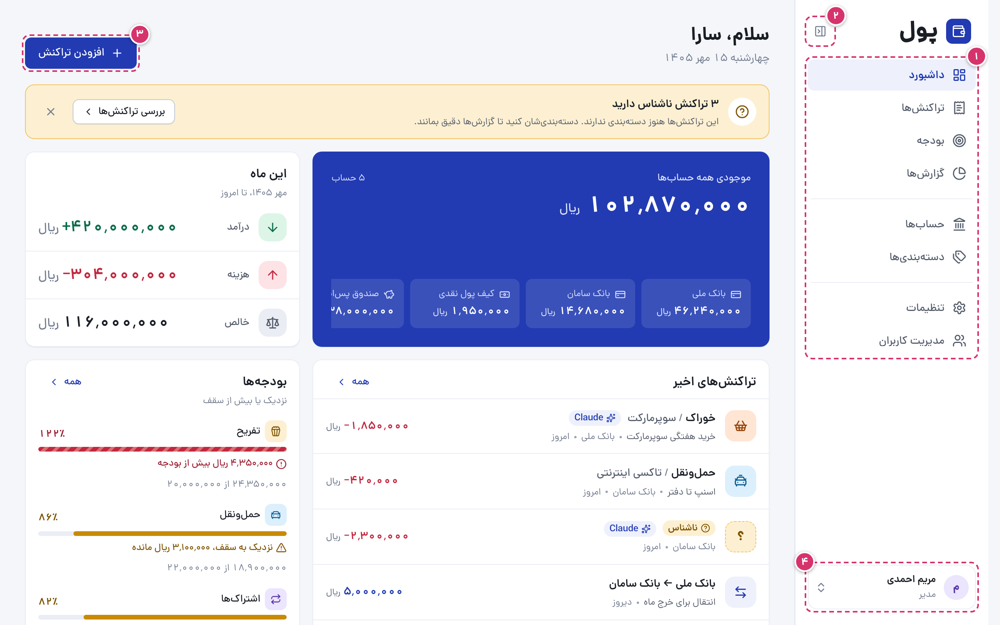

۱. **منو:** «داشبورد»، «تراکنش‌ها»، «بودجه» و «گزارش‌ها»؛ بعد «حساب‌ها» و «دسته‌بندی‌ها»؛ بعد «تنظیمات» (و «مدیریت کاربران» برای مدیرها).

۲. **«جمع کردن منو»** منو را به ستونی از آیکون‌ها کوچک می‌کند. پول انتخابتان را روی همین دستگاه به خاطر می‌سپارد.

۳. **«افزودن تراکنش»** فرم تراکنش تازه را از هر صفحه‌ای باز می‌کند (ویرایشگرها و مدیرها).

۴. **حساب شما:** نام و نقشتان. با کلیک روی آن می‌توانید «خروج» را بزنید.

روی گوشی، منو به نوار کوچکی پایین صفحه تبدیل می‌شود:

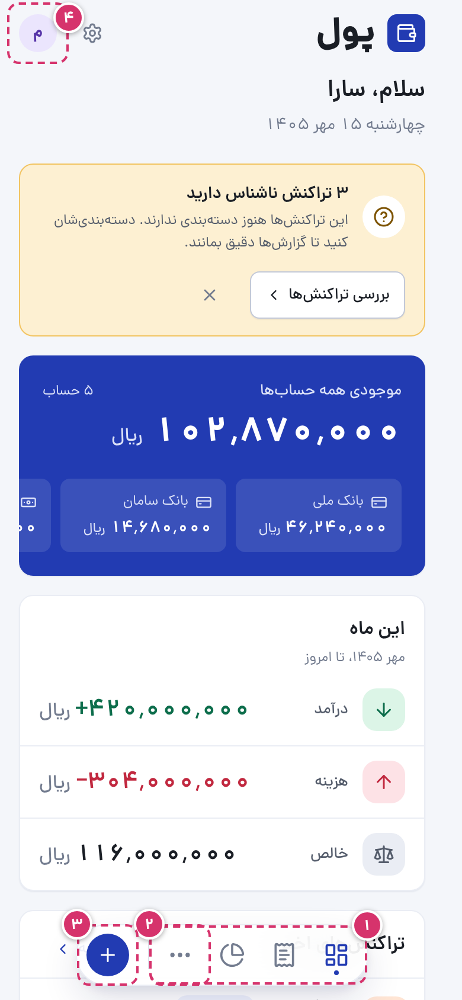

۱. **زبانه‌ها** برای داشبورد، تراکنش‌ها و گزارش‌ها.

۲. **«بیشتر»** بخش‌های دیگر را باز می‌کند: بودجه، حساب‌ها، دسته‌بندی‌ها و مدیریت کاربران.

۳. **+** تراکنش اضافه می‌کند (ویرایشگرها و مدیرها).

۴. **حساب شما** (برای خروج). تنظیمات همان آیکون چرخ‌دنده کنار آن است.

## قدم‌های اول

دفتر تازه خالی است، برای همین داشبورد چهار قدم برای راه‌اندازی نشان می‌دهد. هر قدم که انجام شود، تیک می‌خورد.

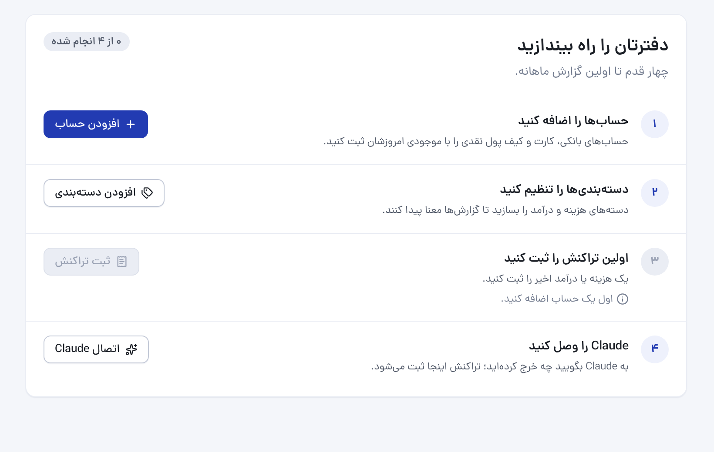

۱. **حساب‌ها را اضافه کنید:** کارت‌ها، حساب‌های بانکی و پول نقدی که می‌خواهید حسابشان را داشته باشید، هر کدام با موجودی امروز.

۲. **دسته‌بندی‌ها را تنظیم کنید:** پولتان از کجا می‌آید و کجا می‌رود. پول یک مجموعهٔ آماده پیشنهاد می‌دهد.

۳. **اولین تراکنش را ثبت کنید.**

۴. **Claude را وصل کنید**، اگر می‌خواهید با گفت‌وگو تراکنش ثبت کنید (بخش Claude و ChatGPT را ببینید).

پیش از ثبت هر مبلغی، مدیر می‌تواند واحد پول دفتر را در تنظیمات از ریال به دلار، یورو یا پوند تغییر دهد. بعداً دیگر قابل تغییر نیست.

## داشبورد

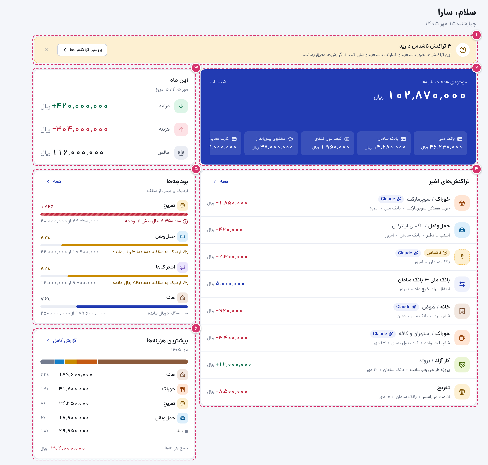

۱. **تراکنش‌های ناشناس:** تراکنش‌هایی که بدون دسته‌بندی ثبت شده‌اند (معمولاً به‌دست Claude یا با درون‌ریزی فایل) برچسب «ناشناس» می‌گیرند تا کسی برایشان دسته‌بندی انتخاب کند. «بررسی تراکنش‌ها» فهرستشان را نشان می‌دهد. می‌توانید این پیام را ببندید؛ با رسیدن تراکنش ناشناس تازه دوباره ظاهر می‌شود.

۲. **«موجودی همه حساب‌ها»** و موجودی هر حساب.

۳. **«این ماه»:** درآمد، هزینه و خالص تا امروز.

۴. **«تراکنش‌های اخیر»:** هشت تراکنش آخر. روی هر کدام بزنید تا جزئیاتش را ببینید.

۵. **«بودجه‌ها»:** بودجه‌هایی که به سقف نزدیک شده‌اند یا از آن گذشته‌اند.

۶. **«بیشترین هزینه‌ها»:** پول این ماه به تفکیک دسته‌بندی کجا رفته است. «گزارش کامل» تفکیک را در گزارش‌ها باز می‌کند.

## حساب‌ها

حساب هر جایی است که پولتان آنجاست: حساب یا کارت بانکی، پول نقد، صندوق پس‌انداز.

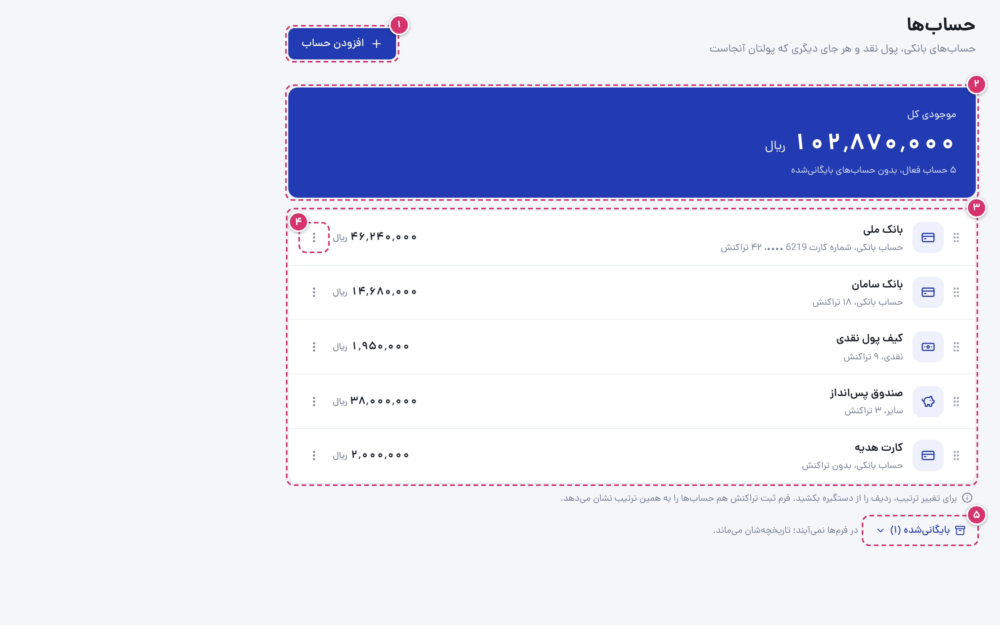

۱. **«افزودن حساب»:** نام، نوع (حساب بانکی، نقدی یا سایر)، موجودی اولیه (می‌تواند منفی هم باشد) و برای حساب بانکی، اگر بخواهید، شمارهٔ کارت، حساب یا شبا. در فهرست‌ها فقط چهار رقم آخرش دیده می‌شود.

۲. **«موجودی کل»** حساب‌های فعال. موجودی هر حساب برابر است با موجودی اولیه به‌علاوهٔ درآمدها و انتقال‌های ورودی، منهای هزینه‌ها و انتقال‌های خروجی.

۳. **حساب‌های شما** با موجودی و تعداد تراکنش‌هایشان. برای تغییر ترتیب، ردیف را از دستگیره‌اش بکشید؛ فرم‌ها حساب‌ها را به همین ترتیب نشان می‌دهند.

۴. **منوی هر حساب:** «ویرایش»، «انتقال به بالا»، «انتقال به پایین»، «بایگانی» و «حذف».

۵. **حساب‌های «بایگانی‌شده»** در فرم‌ها نمی‌آیند، اما تاریخچه‌شان می‌ماند و می‌توانید برشان گردانید. حساب فقط تا وقتی تراکنشی ندارد حذف می‌شود؛ وگرنه بایگانی‌اش کنید.

## دسته‌بندی‌ها

دسته‌بندی‌ها درآمدها و هزینه‌هایتان را مرتب می‌کنند. دسته‌های هزینه و درآمد جدا هستند و هر دسته می‌تواند زیردسته داشته باشد (فقط یک سطح).

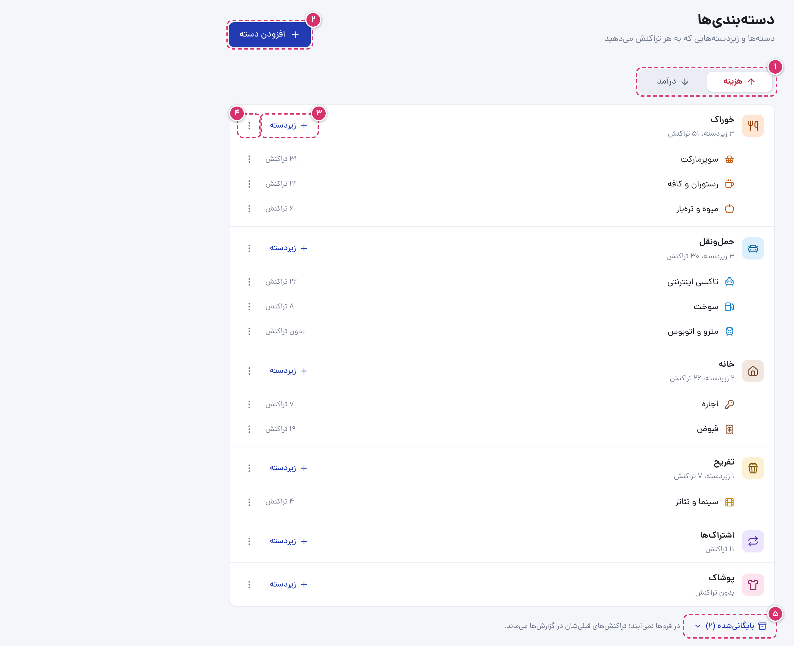

۱. **«هزینه» و «درآمد»:** جابه‌جایی میان دو فهرست.

۲. **«افزودن دسته»:** نام، رنگ و آیکون. پول از روی نام یک آیکون پیشنهاد می‌دهد.

۳. **«زیردسته»** یک زیردسته اضافه می‌کند که رنگ دسته‌اش را می‌گیرد. هر تراکنش می‌تواند یک دسته یا یکی از زیردسته‌هایش را داشته باشد.

۴. **منوی هر دسته:** ویرایش، بایگانی یا حذف.

۵. **دسته‌های «بایگانی‌شده»** در فرم‌ها نمی‌آیند، اما تراکنش‌های گذشته در گزارش‌ها نگهشان می‌دارند. دسته فقط تا وقتی هیچ تراکنشی در آن نیست حذف می‌شود.

## افزودن تراکنش

روی «افزودن تراکنش» (یا روی گوشی، +) بزنید.

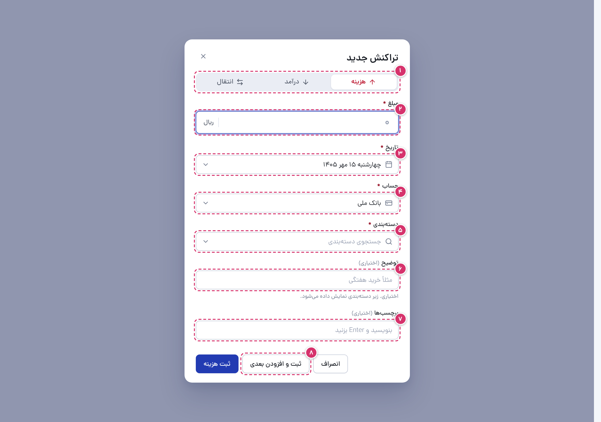

۱. **نوع:** هزینه، درآمد، یا انتقال میان دو حساب خودتان. انتقال جزو درآمد یا هزینه حساب نمی‌شود.

۲. **مبلغ** به واحد پول دفتر. در دفتر ریالی، بسته به انتخابتان در تنظیمات، به ریال یا تومان بنویسید. رقم فارسی هم قبول است.

۳. **تاریخ:** امروز، مگر روز دیگری انتخاب کنید. تاریخ آینده قبول نیست.

۴. **حساب:** پول از کدام حساب آمده یا رفته. برای انتقال، هر دو حساب را می‌پرسد.

۵. **دسته‌بندی** با زیردسته‌هایش. برای جستجو تایپ کنید.

۶. **«توضیح»** (اختیاری): هر چه دسته‌بندی نمی‌گوید، مثل نام فروشگاه یا جزئیاتی که می‌خواهید یادتان بماند.

۷. **برچسب‌ها** (اختیاری)، مثلاً هزینهٔ چه کسی بوده یا مال کدام سفر است.

۸. **«ثبت و افزودن بعدی»** ثبت می‌کند و فرم را با همان نوع، حساب و تاریخ باز نگه می‌دارد تا چند تراکنش را پشت سر هم وارد کنید.

بعد از ثبت، پیامی چند ثانیه «واگرد» را پیشنهاد می‌دهد.

## تراکنش‌ها

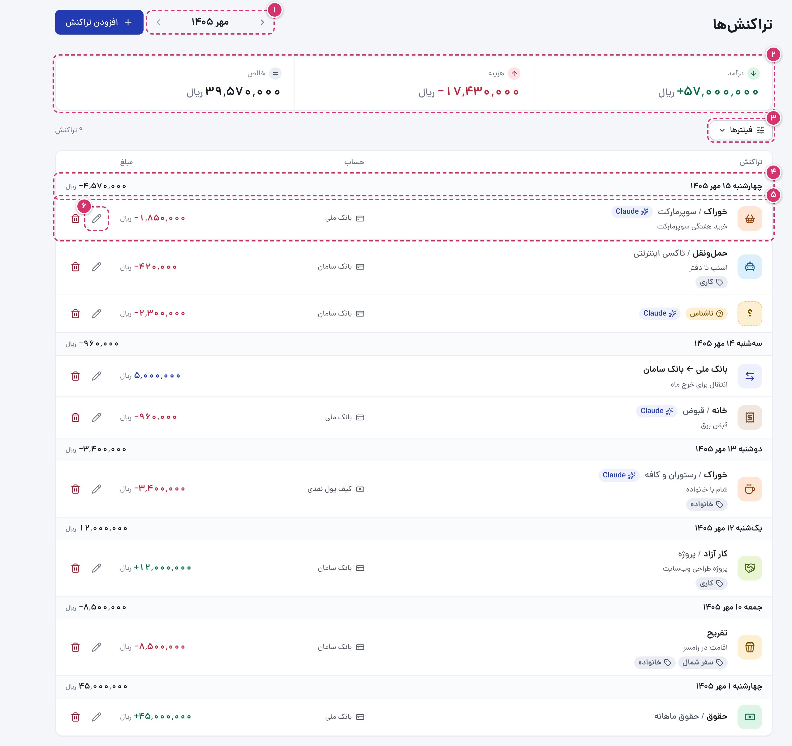

۱. **ماه:** یک ماه عقب یا جلو بروید. با فیلترها می‌توانید هر بازهٔ تاریخی را هم انتخاب کنید.

۲. **درآمد، هزینه و خالص** همهٔ تراکنش‌هایی که نشان داده شده‌اند.

۳. **«فیلترها»:** نوع، حساب، دسته‌بندی، برچسب، ثبت‌کننده، بازهٔ تاریخ و جستجو در توضیح، برچسب‌ها و دسته‌بندی‌ها. فیلتر برچسب می‌تواند فقط تراکنش‌های ناشناس را نشان دهد.

۴. **هر روز** با خالص آن روز.

۵. **هر تراکنش:** دسته‌بندی‌اش (یا «ناشناس»)، توضیح، برچسب‌ها و حساب، و نشان Claude یا ChatGPT اگر با گفت‌وگو ثبت شده باشد. روی آن بزنید تا ببینید چه کسی ثبتش کرده و آخرین بار ویرایشش کرده، و شناسه‌اش را، که می‌توانید کپی کنید و به Claude بدهید.

۶. **ویرایش و حذف** (ویرایشگرها و مدیرها). حذف هم «واگرد» دارد.

## بودجه

بودجه سقف خرج ماهانه برای یک دستهٔ هزینه است. هر ماه تکرار می‌شود و خرج زیردسته‌ها هم جزو آن حساب می‌شود.

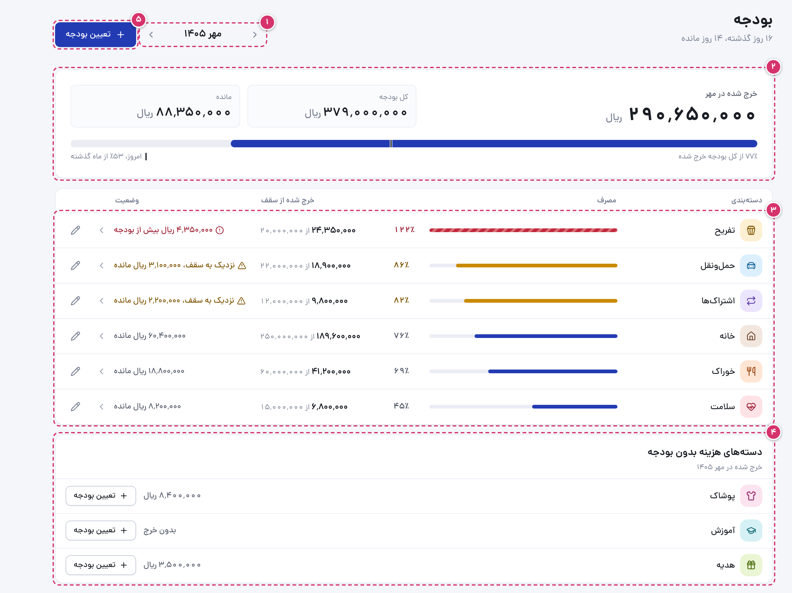

۱. **ماه:** هر ماه گذشته یا آینده. «ماه جاری» به ماه امروز برمی‌گردد.

۲. **ماه در یک نگاه:** خرج‌شده، کل بودجه و مانده، با یک نوار برای همه. خط روی نوار نشان می‌دهد چقدر از ماه گذشته، تا ببینید خرجتان از زمان جلوتر است یا نه.

۳. **بودجه‌های شما**، پرمصرف‌ترها اول. از ۸۰٪ «نزدیک به سقف» و بالای ۱۰۰٪ «بیش از بودجه». روی هر ردیف بزنید تا تراکنش‌هایش را ببینید؛ مداد بودجه را تغییر می‌دهد یا حذف می‌کند.

۴. **دسته‌های هزینه بدون بودجه**، با خرج این ماهشان.

۵. **«تعیین بودجه»** برای یک دسته.

## گزارش‌ها

گزارش‌ها هر دوره را با دورهٔ پیش از آن مقایسه می‌کنند. انتقال‌ها هیچ‌جا حساب نمی‌شوند.

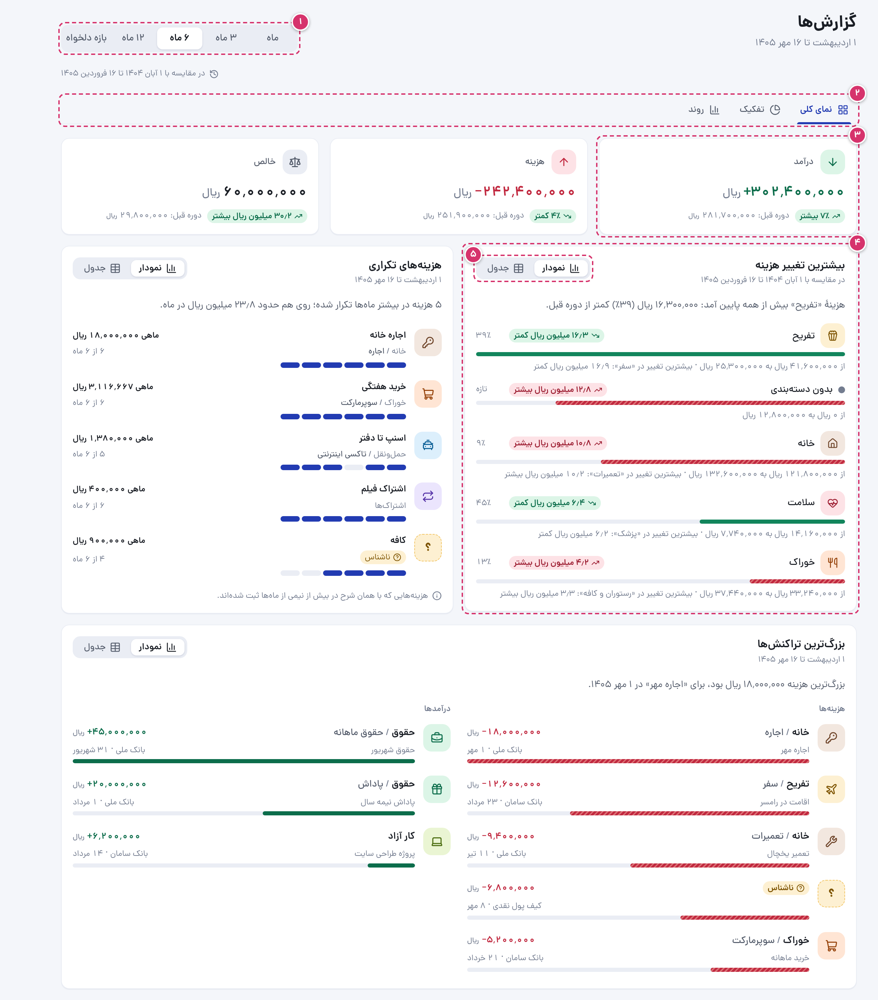

۱. **دورهٔ گزارش:** یک ماه، ۳، ۶ یا ۱۲ ماه اخیر، یا بازهٔ دلخواه.

۲. **زبانه‌ها:** «نمای کلی» (جمع‌ها و نکته‌ها)، «تفکیک» (به تفکیک دسته‌بندی و حساب) و «روند» (ماه به ماه، نرخ پس‌انداز، اینکه بودجه‌ها چند بار رعایت شدند).

۳. **درآمد، هزینه و خالص**، هر کدام با میزان تغییرش نسبت به دورهٔ قبل.

۴. **نکته‌ها**، هر کدام با یافته‌اش در یک جمله: بیشترین تغییر هزینه، هزینه‌های تکراری، بزرگ‌ترین تراکنش‌ها.

۵. **«نمودار» یا «جدول»:** هر نمودار را می‌شود به‌صورت جدولی با همان عددها خواند.

## Claude و ChatGPT

می‌توانید با گفت‌وگو با Claude یا ChatGPT تراکنش ثبت کنید و دربارهٔ خرج‌هایتان بپرسید: پیامک بانک را بچسبانید، بگویید «دیروز ۸۵۰ هزار تومن خرید هفتگی کردم، از کارت ملت»، یا بپرسید «این ماه چقدر خرج رستوران کردم؟». دستیار با نقش شما کار می‌کند: بیننده‌ها فقط می‌توانند بپرسند. صفحه‌اش در «تنظیمات ← اتصال به Claude و ChatGPT» است.

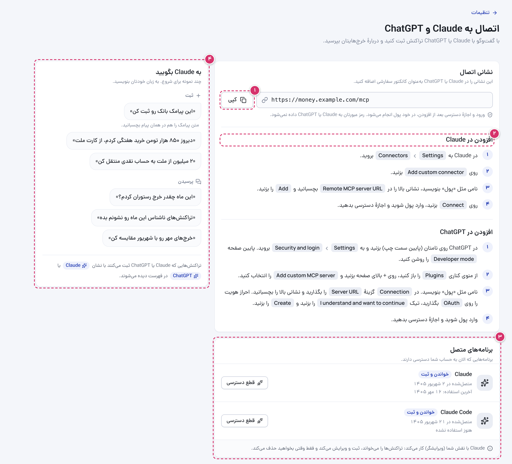

۱. **نشانی اتصال:** آن را کپی کنید.

۲. **مراحل** برای Claude و ChatGPT، که پایین هم آمده‌اند.

۳. **«برنامه‌های متصل»:** دستیارهایی که به حسابتان دسترسی دارند. «قطع دسترسی» یکی را جدا می‌کند.

۴. **«به Claude بگویید»:** چند نمونه برای شروع.

**در Claude:**

۱. به **Settings ← Connectors** بروید و **Add custom connector** را بزنید.

۲. نامی بگذارید (مثلاً «پول»)، نشانی را در **Remote MCP server URL** بچسبانید و **Add** را بزنید. OAuth client ID و secret را خالی بگذارید.

۳. **Connect** را بزنید. پنجرهٔ پول باز می‌شود: وارد شوید و **Allow** را بزنید.

**در ChatGPT:**

۱. روی نامتان (پایین سمت چپ) بزنید، به **Settings ← Security and login** بروید و **Developer mode** را روشن کنید.

۲. از منوی کناری **Plugins** را باز کنید، روی **+** بزنید و **Add custom MCP server** را انتخاب کنید.

۳. نامی بگذارید، **Server URL** را نگه دارید و نشانی را بچسبانید، **Authentication** را روی **OAuth** بگذارید، **I understand and want to continue** را تیک بزنید و **Create** را بزنید.

۴. وارد پول شوید و اجازهٔ دسترسی بدهید.

منوهای ChatGPT گاهی عوض می‌شوند؛ این‌ها همانی است که در مهر ۱۴۰۵ نشان می‌داد.

وقتی دستیار نمی‌تواند دسته‌بندی تراکنشی را تشخیص دهد، آن را «ناشناس» ثبت می‌کند تا بعداً دسته‌بندی‌اش کنید. تغییر رمز عبور، یا بازنشانی رمز و غیرفعال شدن حسابتان به‌دست مدیر، اتصال برنامه‌ها را قطع می‌کند؛ دوباره وصلشان کنید.

## درون‌ریزی و برون‌بری

**«تنظیمات ← درون‌ریزی و برون‌بری».** همه می‌توانند فایل بگیرند؛ ویرایشگرها و مدیرها می‌توانند درون‌ریزی هم بکنند.

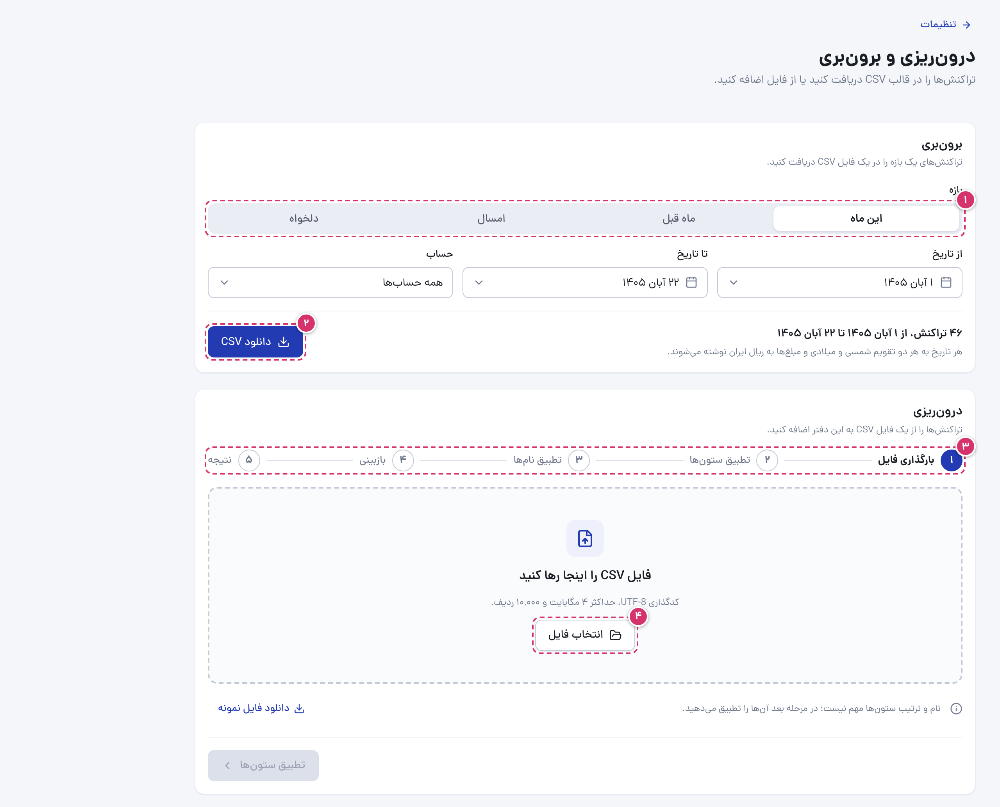

۱. **بازهٔ برون‌بری:** این ماه، ماه قبل، امسال یا تاریخ دلخواه، و یک حساب یا همهٔ حساب‌ها.

۲. **«دانلود CSV»:** فایلی که اکسل و برنامه‌های مشابه باز می‌کنند، با هر تاریخ به هر دو تقویم شمسی و میلادی.

۳. **درون‌ریزی** در پنج مرحله:

- **بارگذاری فایل:** یک فایل CSV با کدگذاری UTF-8، تا ۴ مگابایت و ۱۰٬۰۰۰ ردیف. «دانلود فایل نمونه» قالبش را نشان می‌دهد.
- **تطبیق ستون‌ها:** بگویید کدام ستون تاریخ، مبلغ، نوع، حساب، دسته‌بندی و غیره است. پول از روی نام ستون‌ها حدس می‌زند. در دفتر ریالی بگویید مبلغ‌ها ریال‌اند یا تومان. تاریخ‌ها می‌توانند شمسی یا میلادی باشند، حتی درهم.
- **تطبیق نام‌ها:** حساب‌ها و دسته‌هایی که دفتر هنوز ندارد ساخته می‌شوند یا به موارد موجود وصل می‌شوند.
- **بازبینی:** ردیف‌های آماده، ردیف‌های دارای خطا (با دلیلش) و تکراری‌های احتمالی تراکنش‌های موجود، که اگر خودتان افزودنشان را انتخاب نکنید کنار گذاشته می‌شوند.
- **نتیجه:** چه چیزهایی اضافه و ساخته شد. ردیف‌های ناموفق را می‌شود دانلود کرد، اصلاح کرد و دوباره درون‌ریزی کرد.

۴. **«انتخاب فایل»** برای شروع.

همهٔ ردیف‌های یک درون‌ریزی با هم ذخیره می‌شوند، یا هیچ‌کدام.

## تنظیمات

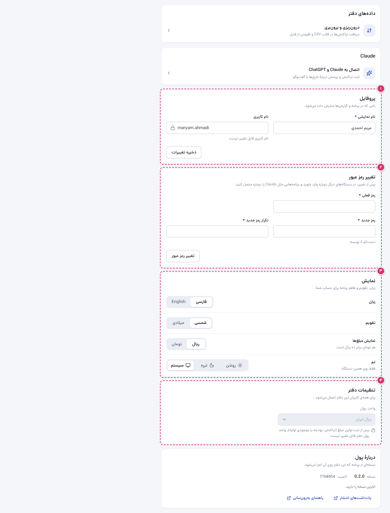

۱. **«پروفایل»:** نامی که دیگران می‌بینند. نام کاربری قابل تغییر نیست.

۲. **«تغییر رمز عبور»:** با این کار از دستگاه‌های دیگرتان خارج می‌شوید و اتصال Claude و ChatGPT قطع می‌شود.

۳. **«نمایش»:** زبان (فارسی یا English)، تقویم (شمسی یا میلادی)، نمایش مبلغ‌ها به ریال یا تومان (دفترهای ریالی) و تم: روشن، تیره یا مثل سیستم، فقط روی همین دستگاه.

۴. **«تنظیمات دفتر»** (مدیرها): واحد پول دفتر. فقط تا وقتی دفتر هیچ مبلغی ندارد قابل تغییر است.

در پایان صفحه، «دربارهٔ پول» نسخهٔ برنامه را نشان می‌دهد. وقتی نسخهٔ تازه‌ای منتشر شود، مدیرها همان‌جا پیامی می‌بینند؛ کسی که نسخهٔ شما را راه انداخته می‌تواند آن را نصب کند ([راهنمای به‌روزرسانی](updating.md)، به انگلیسی).

## مدیریت کاربران

این بخش فقط برای مدیرهاست.

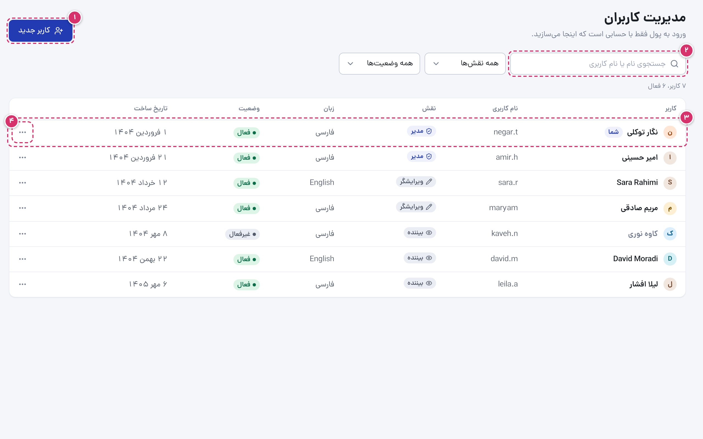

۱. **«کاربر جدید»:** نام نمایشی، نام کاربری، نقش و زبان. پول یک رمز عبور موقت می‌سازد؛ آن را به کاربر بدهید تا بعد از ورود در تنظیمات عوضش کند.

۲. **جستجو** با نام یا نام کاربری، و فیلتر نقش و وضعیت.

۳. **کاربران** با نقش، زبان، وضعیت و تاریخ افزوده شدن.

۴. **منوی هر کاربر:** «تغییر نقش»، «بازنشانی رمز عبور» (یک رمز موقت تازه می‌سازد و کاربر را از همه‌جا خارج می‌کند) و «غیرفعال کردن» (کاربر را خارج و اتصال برنامه‌هایش را قطع می‌کند؛ با فعال کردن برمی‌گردد).

نمی‌توانید نقش خودتان را تغییر دهید یا خودتان را غیرفعال کنید، و دفتر همیشه دست‌کم یک مدیر دارد. یک مدیر دوم هم بسازید تا اگر رمزتان را فراموش کردید، کسی بتواند بازنشانی‌اش کند.

## پرسش‌ها

**رمز عبورم را فراموش کرده‌ام.** از یک مدیر بخواهید در مدیریت کاربران آن را بازنشانی کند. مدیری که رمزش را فراموش کند به مدیر دیگری نیاز دارد.

**دکمهٔ افزودن یا ویرایش را نمی‌بینم.** نقش شما بیننده است. مدیر می‌تواند آن را تغییر دهد.

**چرا نمی‌توانم یک حساب یا دسته را حذف کنم؟** تراکنش دارد. به‌جایش بایگانی‌اش کنید: از فرم‌ها کنار می‌رود و تاریخچه‌اش می‌ماند.

**تراکنش «ناشناس» چیست؟** درآمد یا هزینه‌ای بدون دسته‌بندی. بازش کنید، دسته‌بندی را انتخاب کنید و ذخیره کنید.

**واحد پول اشتباه است.** مدیر می‌تواند آن را در «تنظیمات ← تنظیمات دفتر» عوض کند، اما فقط پیش از ثبت اولین مبلغ.

**انتقال‌ها جزو خرج حساب می‌شوند؟** نه. انتقال پول را میان حساب‌های خودتان جابه‌جا می‌کند، پس موجودی‌ها را تغییر می‌دهد اما هیچ‌وقت در درآمد، هزینه، بودجه یا گزارش‌ها حساب نمی‌شود.

