# Money user guide

How to use Money day to day: recording income and expenses, keeping budgets, reading reports and working with Claude or ChatGPT. [راهنمای فارسی](user-guide.fa.md)

The screenshots show sample data. The numbers on them match the numbered lists under each one.

## Contents

- [Before you start](#before-you-start)
- [Getting around](#getting-around)
- [Your first steps](#your-first-steps)
- [Dashboard](#dashboard)
- [Accounts](#accounts)
- [Categories](#categories)
- [Adding a transaction](#adding-a-transaction)
- [Transactions](#transactions)
- [Budget](#budget)
- [Reports](#reports)
- [Claude and ChatGPT](#claude-and-chatgpt)
- [Import and export](#import-and-export)
- [Settings](#settings)
- [User management (admins)](#user-management-admins)
- [Questions](#questions)

## Before you start

Money is one shared book for your family: everyone works on the same accounts, categories, transactions and budgets. What you can do depends on your **role**:

| Role   | Can                                                                                          |
| ------ | -------------------------------------------------------------------------------------------- |
| Viewer | See everything and export CSV files. Pages show «View only» and have no add or edit buttons. |
| Editor | Also add, edit and delete transactions, accounts, categories and budgets, and import CSV.    |
| Admin  | Also create users, reset passwords, change roles and set the book's currency.                |

There is no sign-up page. An admin creates your account and gives you a username and a temporary password; sign in with them and change the password in [Settings](#settings). If you forget it, ask an admin to reset it (Money can't send emails).

## Getting around

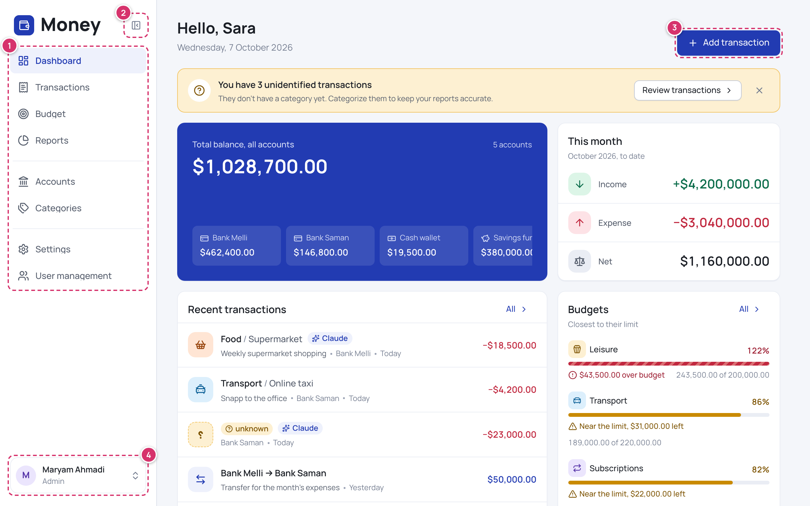

1. **The menu:** Dashboard, Transactions, Budget and Reports; then Accounts and Categories; then Settings (and User management for admins).
2. **Collapse menu** shrinks the menu to icons. Money remembers your choice on this device.
3. **Add transaction** opens the form for a new transaction from any page (editors and admins).
4. **Your account:** your name and role. Click it to sign out.

On a phone, the menu becomes a small bar at the bottom of the screen:

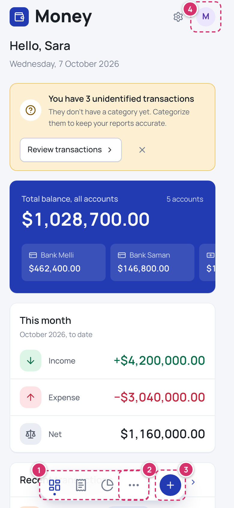

1. **Tabs** for the dashboard, transactions and reports.
2. **More** opens the other sections: budget, accounts, categories and user management.
3. **+** adds a transaction (editors and admins).
4. **Your account** (sign out). Settings is the gear icon next to it.

## Your first steps

A new book is empty, so the dashboard shows four steps to set it up. Each step is checked off when it's done.

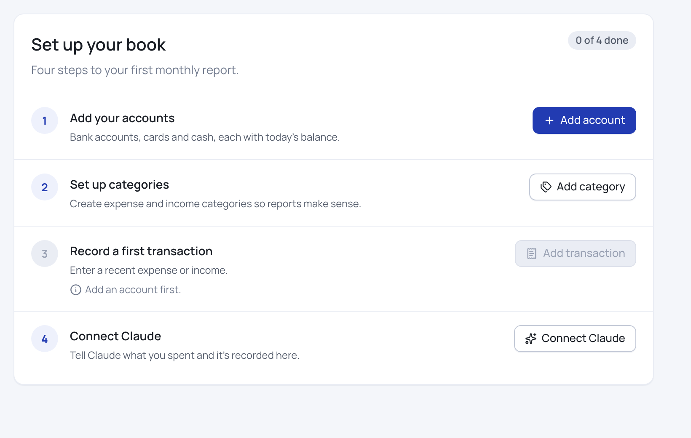

1. **Add your accounts:** the bank cards, accounts and cash you keep track of, each with today's balance.
2. **Set up categories:** what your money comes from and goes to. Money suggests a ready-made set.
3. **Record a first transaction.**
4. **Connect Claude**, if you'd like to record transactions by chatting (see [Claude and ChatGPT](#claude-and-chatgpt)).

Before recording amounts, an admin can switch the book's currency from rial to dollar, euro or pound in [Settings](#settings). It can't change later.

## Dashboard

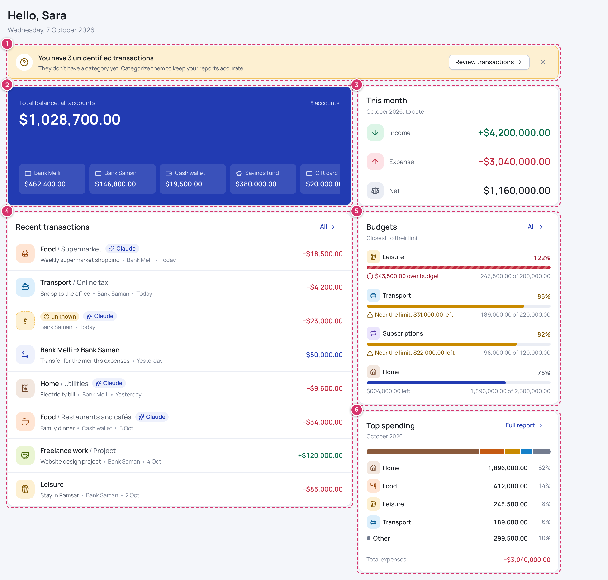

1. **Unknown transactions:** transactions saved without a category (usually by Claude or a CSV import) are marked «unknown» until someone picks one. **Review transactions** lists them. You can close the notice; it comes back when a new unknown transaction arrives.
2. **Total balance, all accounts**, and the balance of each account.
3. **This month:** income, expense and net so far.
4. **Recent transactions:** the last eight. Click one to see its details.
5. **Budgets:** the ones closest to or over their limit.
6. **Top spending:** where this month's money went, by category. **Full report** opens the breakdown in Reports.

## Accounts

An account is anywhere your money sits: a bank account or card, cash, a savings fund.

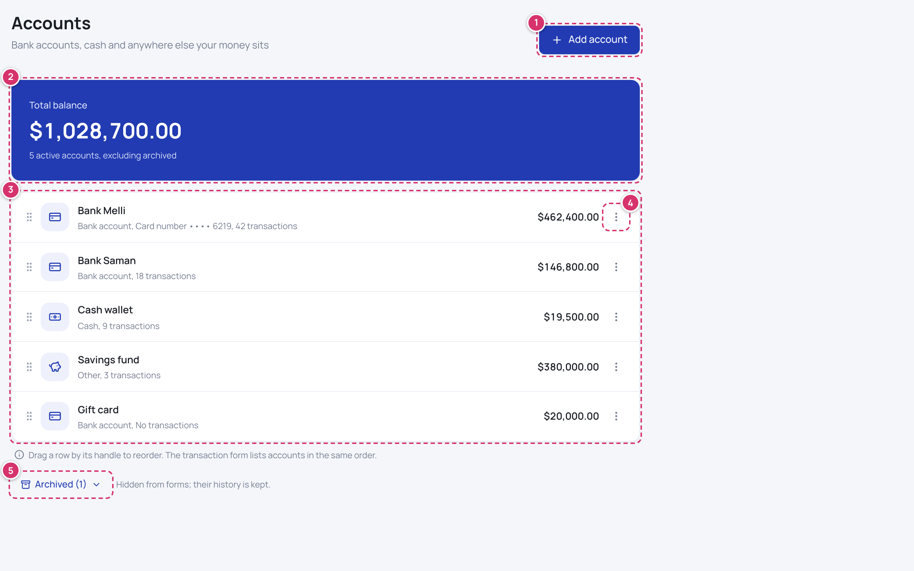

1. **Add account:** a name, a type (bank account, cash or other), the starting balance (it may be negative), and for a bank account optionally its card, account or Sheba number. Lists show only its last four digits.
2. **Total balance** of all active accounts. Each account's balance is its starting balance plus its income and incoming transfers, minus its expenses and outgoing transfers.
3. **Your accounts**, with their balance and number of transactions. Drag a row by its handle to change the order; forms list accounts in the same order.
4. **The menu** of an account: **Edit**, **Move up**, **Move down**, **Archive** and **Delete**.
5. **Archived** accounts are hidden from forms, but their history stays and you can restore them. An account can only be deleted while it has no transactions; otherwise archive it.

## Categories

Categories sort your income and expenses. Expense and income categories are separate, and each category can have subcategories (one level).

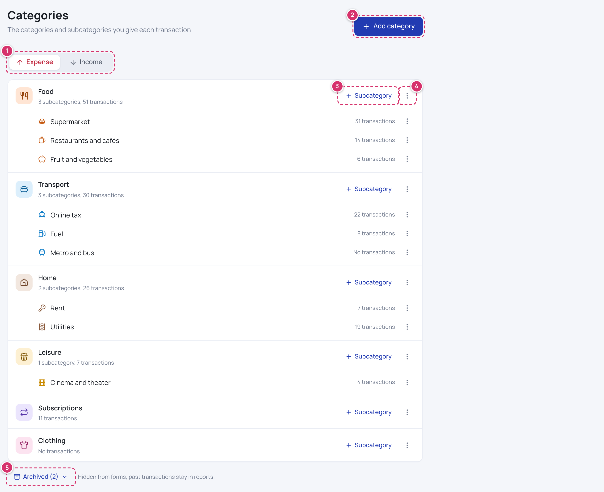

1. **Expense** and **Income**: switch between the two lists.
2. **Add category:** a name, a color and an icon. Money suggests an icon from the name.
3. **Subcategory** adds a subcategory, which takes its category's color. A transaction can use a category or one of its subcategories.
4. **The menu** of a category: edit, archive or delete it.
5. **Archived** categories are hidden from forms, but past transactions keep them in reports. A category can only be deleted while nothing in it has transactions.

## Adding a transaction

Click **Add transaction** (or **+** on a phone).

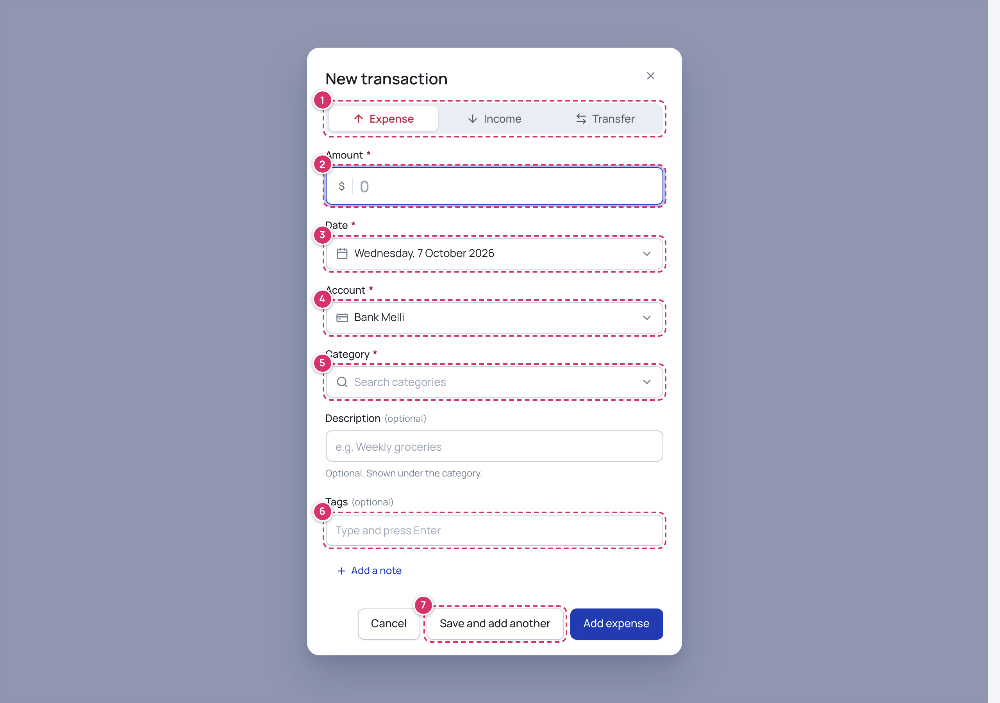

1. **Type:** expense, income, or a transfer between two of your own accounts. Transfers don't count as income or expense.
2. **Amount**, in the book's currency. In a rial book you can type in rials or tomans, as you chose in [Settings](#settings). Persian digits work too.
3. **Date:** today unless you pick another day. It can't be in the future.
4. **Account:** where the money came from or went to. A transfer asks for both accounts.
5. **Category**, with its subcategories. Type to search.
6. **Tags** (optional), for example whose expense it was or a trip it belongs to. Add a description and **Add a note** for more detail.
7. **Save and add another** saves and keeps the form open with the same type, account and date, for entering several at once.

After saving, a message offers **Undo** for a few seconds.

## Transactions

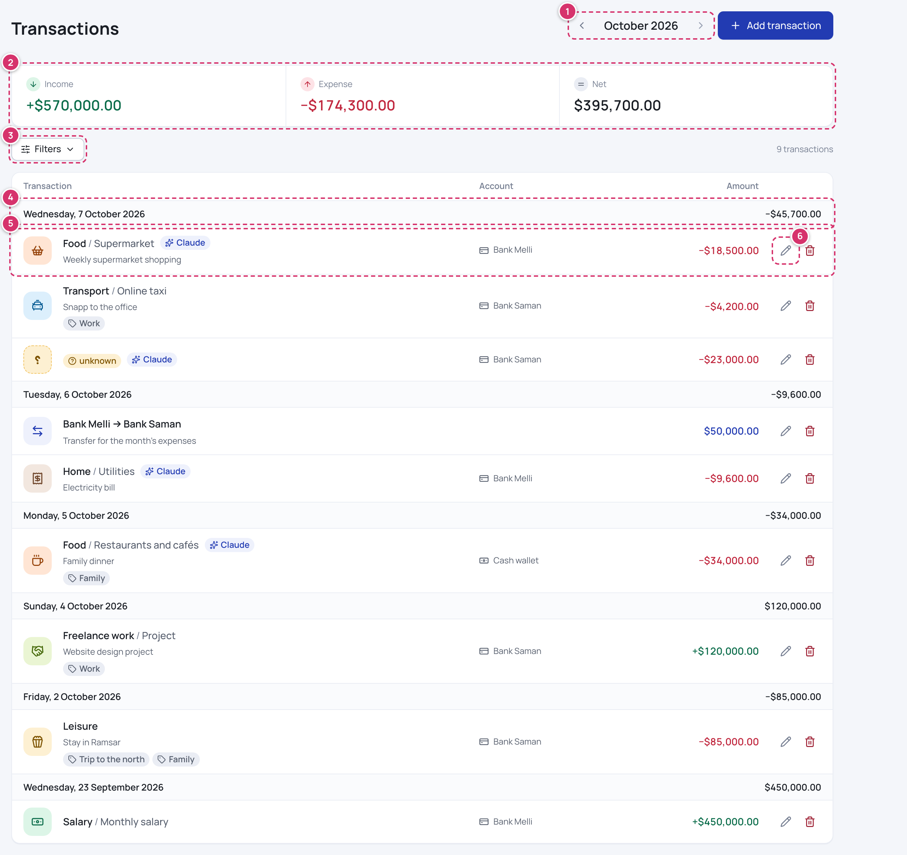

1. **The month:** go back or forward a month. Filters can choose any date range instead.
2. **Income, expense and net** for everything shown.
3. **Filters:** type, account, category, tag, who added it, a date range and a search of descriptions, notes, tags and categories. The tag filter can show only the unknown transactions.
4. **Each day** with its net.
5. **A transaction:** its category (or «unknown»), its description, tags and account, and a Claude or ChatGPT badge if it was added by chat. Click it to see who added and last edited it, and its ID, which you can copy and give to Claude.
6. **Edit** and **Delete** (editors and admins). Deleting offers **Undo** too.

## Budget

A budget is a monthly spending limit for an expense category. It repeats every month, and spending in its subcategories counts toward it.

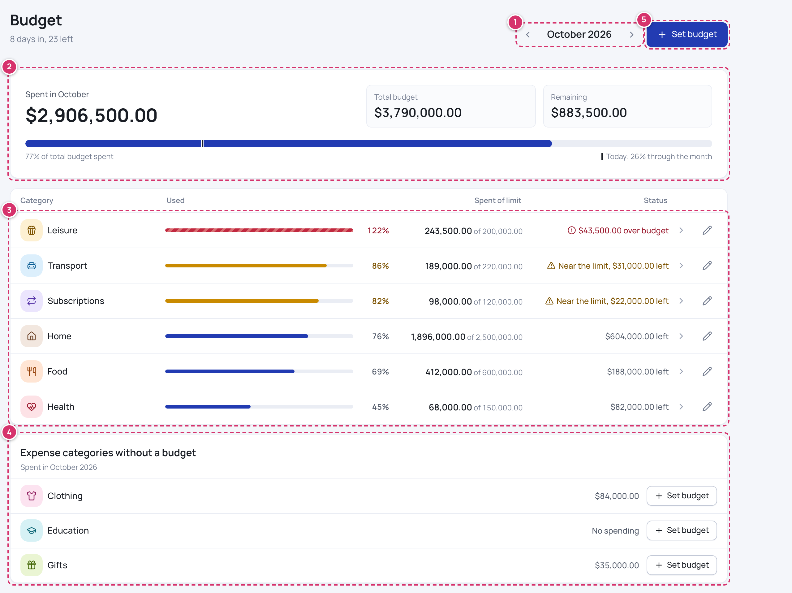

1. **The month:** any past or future month. **This month** returns to today's month.
2. **The month at a glance:** spent, total budget and remaining, and one bar for all of it. The line marks how far into the month today is, so you can tell whether spending is ahead of time.
3. **Your budgets**, most used first. «Near the limit» from 80%, «over budget» beyond 100%. Click a row to see its transactions; the pencil changes or removes the budget.
4. **Expense categories without a budget**, with what they spent this month.
5. **Set budget** for a category.

## Reports

Reports compare a period with the one before it. Transfers never count.

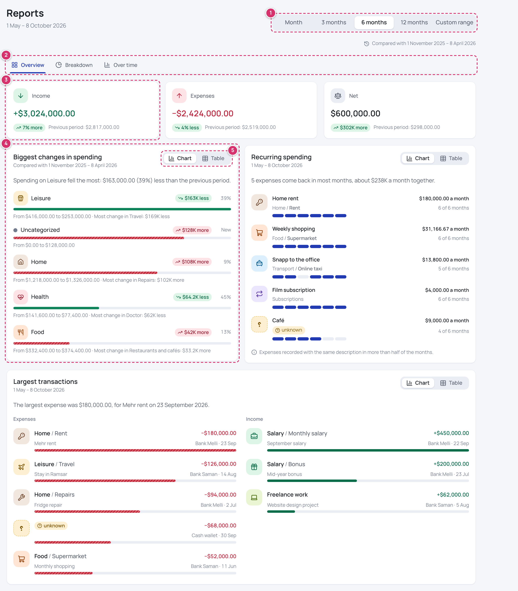

1. **Report period:** a month, the last 3, 6 or 12 months, or a custom range.
2. **Tabs:** **Overview** (totals and insights), **Breakdown** (by category and by account) and **Over time** (month by month, savings rate, how often budgets held).
3. **Income, expenses and net**, each with how much it changed from the previous period.
4. **Insights**, each with its finding in one sentence: the biggest changes in spending, recurring spending, the largest transactions.
5. **Chart** or **Table**: every chart can be read as a table with the same figures.

## Claude and ChatGPT

You can record transactions and ask about your spending by chatting with Claude or ChatGPT: paste a bank SMS, say "Spent 850k toman on groceries yesterday, Mellat card", or ask "How much did I spend on restaurants this month?". The assistant works with your role: viewers can only ask. The page is **Settings → Connect Claude and ChatGPT**.

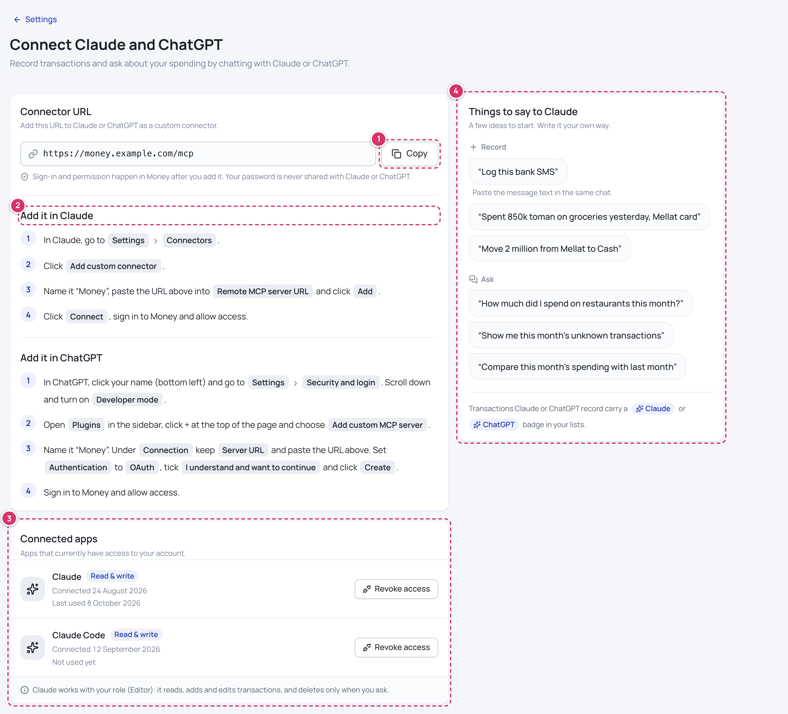

1. **The connector URL:** copy it.
2. **The steps** for Claude and for ChatGPT, also below.
3. **Connected apps:** the assistants that can use your account. **Revoke access** disconnects one.
4. **Things to say to Claude:** examples to start with.

**In Claude:**

1. Go to **Settings → Connectors** and click **Add custom connector**.
2. Name it (for example "Money"), paste the URL into **Remote MCP server URL** and click **Add**. Leave the OAuth client ID and secret empty.
3. Click **Connect**. A Money window opens: sign in, then click **Allow**.

**In ChatGPT:**

1. Click your name (bottom left), go to **Settings → Security and login** and turn on **Developer mode**.
2. Open **Plugins** in the sidebar, click **+** and choose **Add custom MCP server**.
3. Name it, keep **Server URL** and paste the URL, set **Authentication** to **OAuth**, tick **I understand and want to continue** and click **Create**.
4. Sign in to Money and allow access.

ChatGPT's menus change from time to time; these are the ones it showed in October 2026.

When the assistant can't tell a transaction's category, it saves it as «unknown» for you to categorize later. Changing your password, or an admin resetting it or disabling your account, disconnects your apps; connect them again.

## Import and export

**Settings → Import and export.** Everyone can export; editors and admins can import.

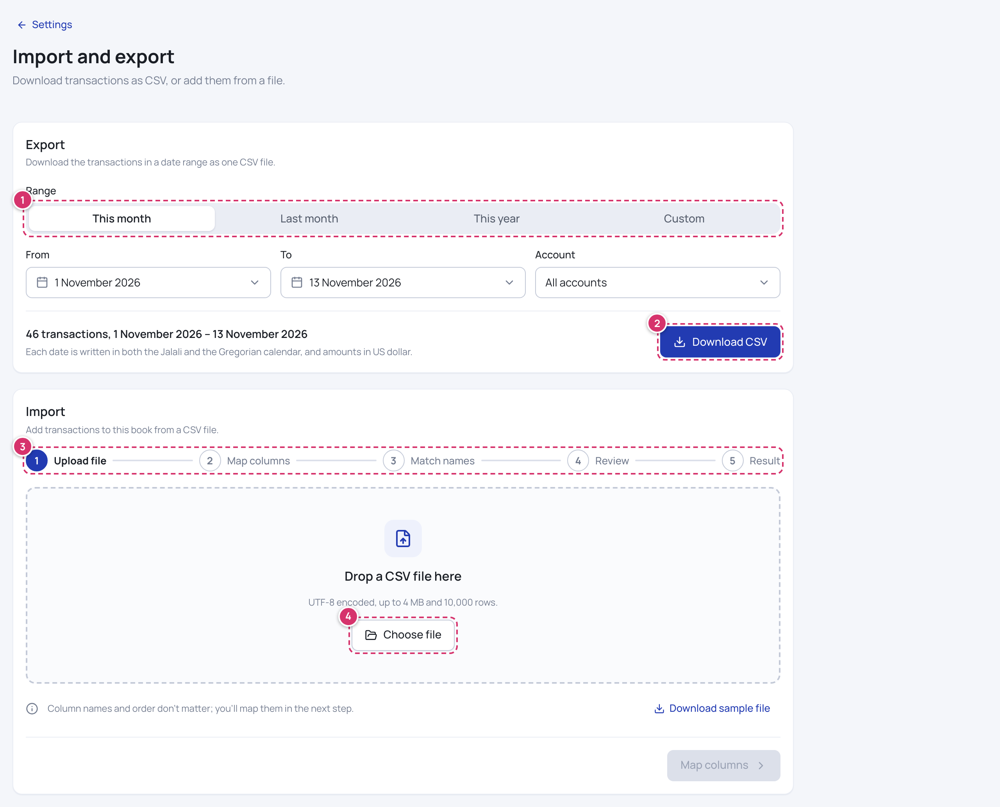

1. **Export range:** this month, last month, this year or custom dates, and an account or all of them.
2. **Download CSV:** a file that Excel and other spreadsheets open, with each date in both the Jalali and the Gregorian calendar.
3. **Import** in five steps:
   - **Upload file:** a UTF-8 CSV file of up to 4 MB and 10,000 rows. **Download sample file** shows the format.
   - **Map columns:** say which column is the date, amount, type, account, category and so on. Money guesses from the column names. In a rial book, say whether the amounts are in rials or tomans. Dates can be Jalali or Gregorian, even mixed.
   - **Match names:** accounts and categories the book doesn't have yet become new ones, or are matched to existing ones.
   - **Review:** the rows that are ready, the rows with errors (with the reason), and possible duplicates of transactions already in the book, which are skipped unless you choose to add them.
   - **Result:** what was added and created. Rows that failed can be downloaded, fixed and imported again.
4. **Choose file** to start.

Everything in one import is saved together, or nothing is.

## Settings

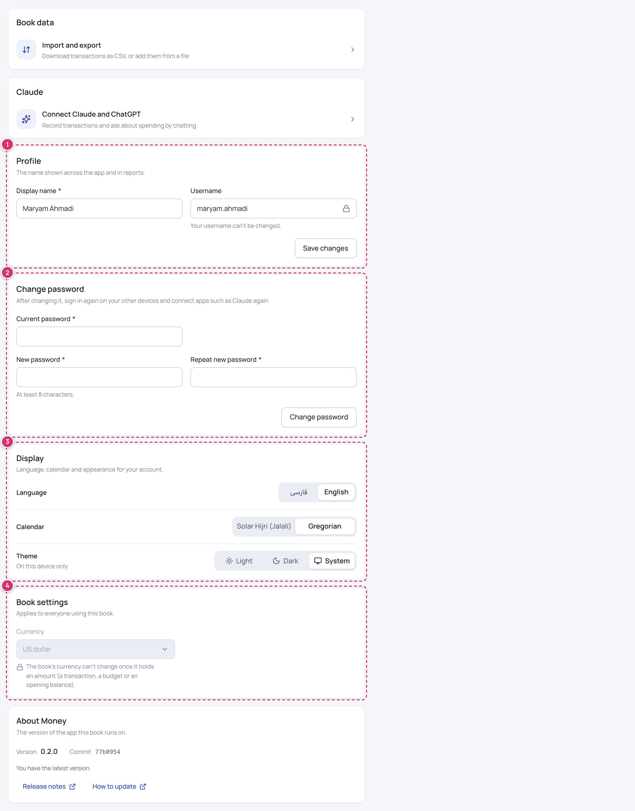

1. **Profile:** the name others see. Your username can't change.
2. **Change password:** this signs you out on your other devices and disconnects Claude and ChatGPT.
3. **Display:** language (فارسی or English), calendar (Jalali or Gregorian), whether amounts show in rials or tomans (rial books), and the theme: light, dark or the system's, on this device only.
4. **Book settings** (admins): the book's currency. It can only change while the book has no amounts.

At the end, **About Money** shows the version. Admins see a notice there when a new version is out; the person who set up your copy can install it ([updating](updating.md)).

## User management (admins)

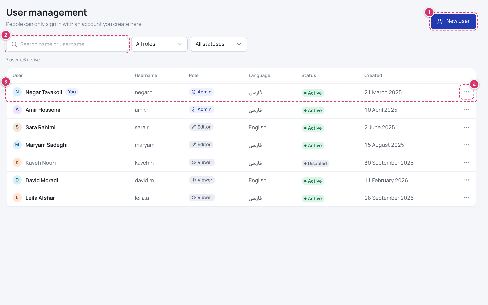

1. **New user:** display name, username, role and language. Money makes a temporary password; give it to the person, and they change it in Settings after signing in.
2. **Search** by name or username, and filter by role and status.
3. **The users** with their role, language, status and when they were added.
4. **The menu** of a user: **Change role**, **Reset password** (makes a new temporary password and signs them out everywhere) and **Disable** (signs them out and disconnects their apps; **Enable** brings them back).

You can't change your own role or disable yourself, and the book always keeps at least one admin. Make a second admin, so someone can reset your password if you forget it.

## Questions

**I forgot my password.** Ask an admin to reset it in User management. An admin who forgets theirs needs another admin.

**I don't see an add or edit button.** Your role is Viewer. An admin can change it.

**Why can't I delete an account or category?** It has transactions. Archive it instead: it disappears from forms and keeps its history.

**What is an «unknown» transaction?** An income or expense without a category. Open it, pick a category and save.

**The currency is wrong.** An admin can change it in Settings → Book settings, but only before the book holds any amount.

**Do transfers count as spending?** No. They move money between your own accounts, so they change balances but never income, expense, budgets or reports.
